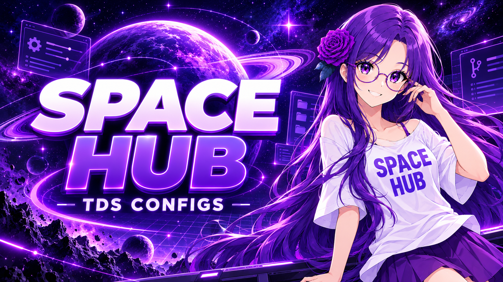

<div align="center">



# Space Hub · TDS Configs

**Recorded Tower Defense Simulator strategies, organized automatically.**

The catalog has been reset. New recorder uploads will appear here.

**📦 500 strategies &nbsp; • &nbsp; 🎮 4 categories**

</div>

<h2 align="center">📚 Strategy catalog</h2>

<p align="center">Choose a category, then open the required mode, story, trial, event stage, or map.</p>

<div align="center">

| Category | Strategies | Open |
|:---:|---:|:---:|

| Survival | 402 | [Open](Survival/README.md) |
| Event | 55 | [Open](Event/README.md) |
| Sandbox | 23 | [Open](Sandbox/README.md) |
| Arcade | 20 | [Open](Arcade/README.md) |
</div>

---

<h2 align="center">🚀 How do I use a recorded or downloaded TDS macro?</h2>

<p align="center">Download the required macro file, put it into <code>executor/autoexec</code>, and rename it to <code>config.lua</code>.<br>Make sure every file is in the correct folder, or the macro will not run properly.</p>

---

<h2 align="center">🏆 Can TDS restart automatically after Triumph?</h2>

<p align="center"><b>No.</b> TDS does not allow an automatic restart after Triumph.<br>After a win, the available flow is to rejoin.</p>

---

<h2 align="center">🗂️ Repository structure</h2>

```text
Survival/<Mode>/<Map>/<Number>-<UTC timestamp>.txt
Event/<Event>/<Story or stage>/<Number>-<UTC timestamp>.txt
Story/<Story>/<Map>/<Number>-<UTC timestamp>.txt
Arcade/<Mode>/<Number>-<UTC timestamp>.txt
Arcade/Trials/<Trial>/<Number>-<UTC timestamp>.txt
Sandbox/<Map>/<Number>-<UTC timestamp>.txt
```

<p align="center">Numbers are assigned independently inside every final folder.</p>

---

<p align="center"><sub>Maintained automatically by <b>Space Hub API Service</b> 💜</sub></p>
